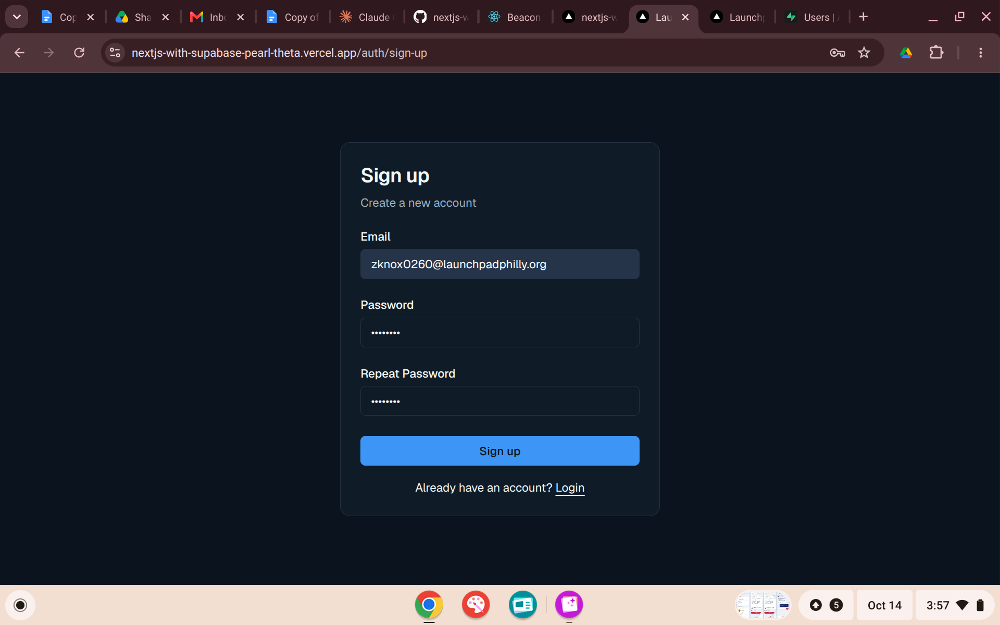
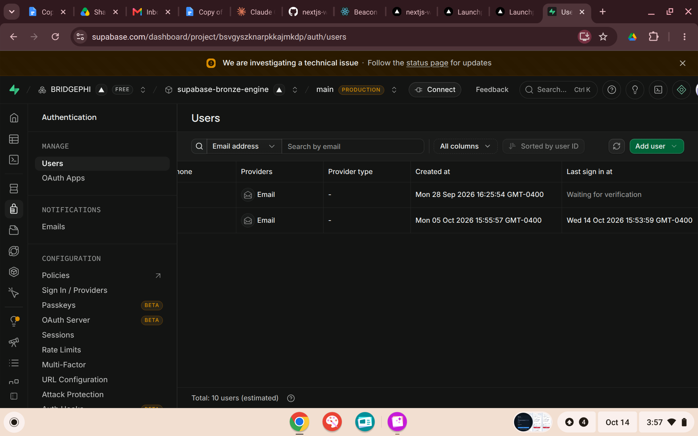
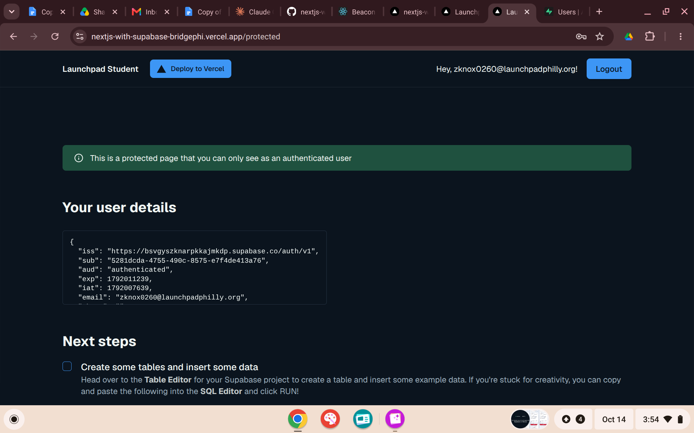
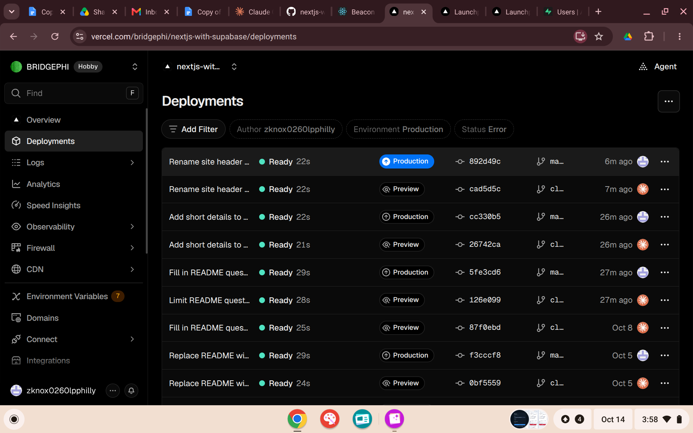
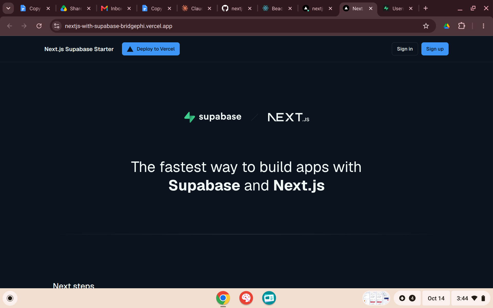
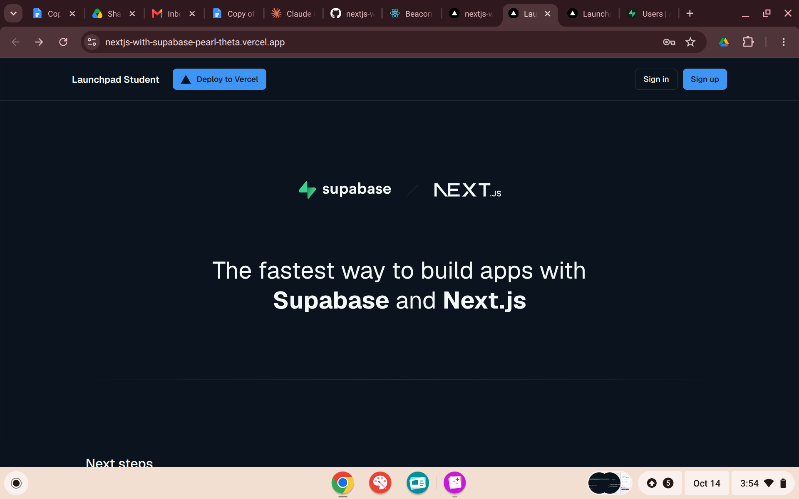
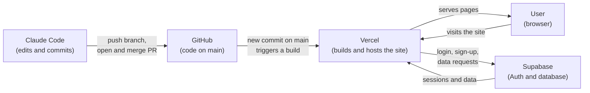

# Project Questions

## 1. Where does your code live?

On GitHub, in the repository [`zknox0260lpphilly/nextjs-with-supabase`](https://github.com/zknox0260lpphilly/nextjs-with-supabase). The `main` branch is the source of truth. It is a Next.js app (App Router, Tailwind CSS, shadcn/ui) that uses Supabase for login. Pages are in `app/`, shared components in `components/`, and the Supabase connection code in `lib/supabase/`.

## 2. Where does your data live, and what is stored there right now?

In a Supabase project (Postgres database plus Supabase Auth). The app finds it through two environment variables, `NEXT_PUBLIC_SUPABASE_URL` and `NEXT_PUBLIC_SUPABASE_PUBLISHABLE_KEY`, which are kept out of the repo (only `.env.example` is committed).

What the code stores right now:
- **User accounts.** Sign-up, login, logout and password reset all go through Supabase Auth, so emails and password hashes live in Supabase's auth users table.
- **No app tables yet.** The repo has no database migrations and the app code reads and writes no tables. The only table reference is a `notes` table in the optional tutorial component (`components/tutorial/fetch-data-steps.tsx`), which only exists if someone created it in Supabase.

I can't see inside the live Supabase project from the code, so the exact current contents (how many users, whether a `notes` table exists) need to be checked in the Supabase dashboard.

The live site's sign-up page, where people create these accounts:

The Supabase dashboard (Authentication, Users) showing the accounts that sign-up created. Both use the Email provider, and one is still "Waiting for verification":

After signing in, the app's protected page shows the signed-in user's details, which come from Supabase Auth. The header also shows the new "Launchpad Student" name:

## 3. How does a change get from Claude Code to the live site? List the steps.

1. Claude Code edits the files on a working branch (for example `claude/nice-keller-k5sw98`).
2. It commits the change.
3. It pushes the branch to GitHub.
4. A pull request is opened from that branch into `main`.
5. The pull request is reviewed and merged into `main`.
6. Vercel, connected to the GitHub repo, sees the new commit on `main`, builds the app and publishes it to the live site. The Supabase environment variables are set in the Vercel project.

Steps 1 to 5 are what we did in this project. Step 6 is confirmed by the Vercel dashboard: the repo is connected to a Vercel project, and every push to `main` creates a Production deployment (each pull request branch also gets a Preview deployment). The latest Production deployment is the "Rename site header" commit `892d49c` from `main`.

The result on the live site. Before the rename, the header said "Next.js Supabase Starter":

After the change was merged to `main` and deployed, the header says "Launchpad Student":

## 4. What will you need to add to turn this into your team's app? Use your product manager's feature list.

**Ekip** is a support platform for the Haitian community. It connects people who need resources with individuals, schools, organizations and volunteers who can help.

The features to add are:

1. **Education** - Access to educational resources, information and opportunities. For example, a school that needs computers can post that need, and an individual or organization with computers can find the post, contact the school and arrange the donation. Help types include school supplies, tutoring and scholarships.
2. **Job** - Opportunities for community members, including volunteering, so people can offer their time and skills and find ways to help.
3. **Multilingualism** - The app is available in Haitian Creole, French, Spanish and English to reduce language barriers. Users choose their language, say where they are located, and select the type of help they need or want to offer.

## 5. A diagram: boxes for the user, GitHub, Vercel and Supabase, with arrows showing what connects to what.

