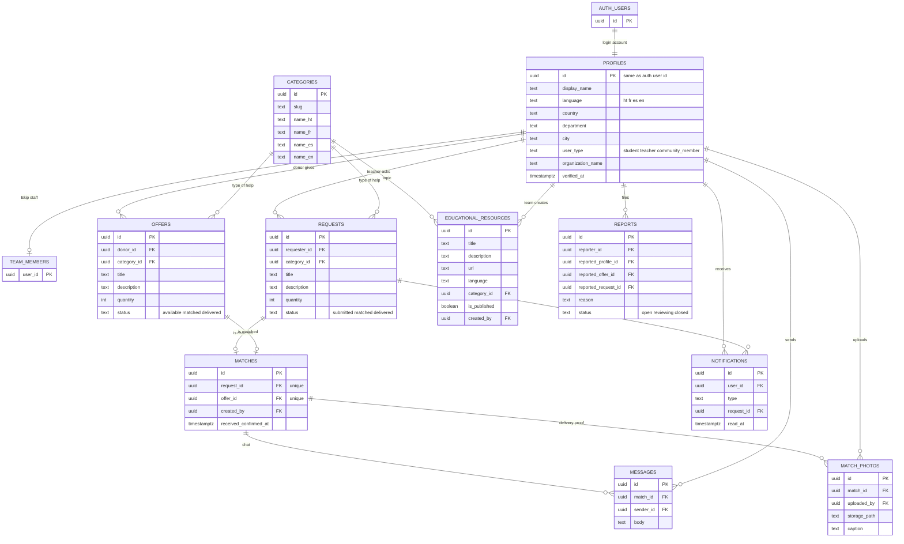

# Ekip database

The MVP database for Ekip, built from the Product Requirements Document. It runs on Supabase (Postgres).

- **`schema.sql`**: the SQL for every table, the security rules and the photo storage bucket. Paste it into the Supabase SQL Editor and run it once on a fresh project.
- **Map of the database** (below): how the tables connect. The same picture is saved as `erd.png`.

## Map of the database

## What each table is for

| Table | What it holds | PRD requirement it covers |
| --- | --- | --- |
| `profiles` | One row per user: language, country, city, and whether they are a student, teacher or community member. Login itself lives in Supabase's `auth.users`. A profile is created automatically at sign-up. | Language, country and user type screens |
| `categories` | Types of help (computers, Chromebooks, books, school supplies, information, volunteer support), with a name in each of the four languages. | Display in Creole and other languages |
| `educational_resources` | The library shown on the Home screen, one row per language version. Managed by the Ekip team. | Display educational resources in Haitian Creole and other languages |
| `requests` | A teacher asks for computers or Chromebooks. Status: `submitted`, `matched`, `delivered`. | Teachers submit requests, track status |
| `offers` | A community member offers to donate something. Status: `available`, `matched`, `delivered`. | Community members offer and donate |
| `matches` | Pairs one request with one offer. A donor creates it by accepting a request. The teacher confirms receipt on it. | Match requests with offers, confirm receipt |
| `messages` | Chat between the two people in a match. | Teachers and donors communicate |
| `match_photos` | The confirmation photo sent when help is provided. The file itself is stored privately in the `delivery-photos` bucket. | Images screen |
| `notifications` | One row per Ekip team member whenever a teacher submits a request. | Notify the team of new requests |
| `reports` | Anyone can report a profile, offer or request that looks like a scam. The team reviews it. | Basic safety against scams |
| `team_members` | Which users are Ekip staff. Added by hand in the SQL Editor, never by the app. | Supports the notification, report and resource rules |

## How the statuses move

1. A teacher creates a **request** (`submitted`). The team gets a notification.
2. A donor accepts it with one of their **offers**. This creates a **match**, and the request and offer both become `matched`.
3. The two chat in **messages** and can attach a **match photo**.
4. The teacher confirms receipt on the match. The request and offer both become `delivered`.

The database does steps 2 and 4 by itself with triggers, so the app never sets a status directly.

## Who can see and change what

- Everything is locked by default. Row Level Security is on for every table.
- Signed-in users can browse requests and offers, and edit or delete their own while they are still `submitted` or `available`.
- Only the two people in a match (and the Ekip team) can see the match, its chat and its photos.
- Nobody can edit their own `verified_at`. The Ekip team sets it after checking a person.
- Anyone, even before logging in, can read the categories and published educational resources, so the language and home screens work first.

## Not in the MVP

- The job, course and training section is Stretch in the PRD, so it has no tables yet.
- A match is one request to one offer. Splitting a large request across several donors would need a change.
- Sending an email or text when the team is notified is not set up. The notification row is created, and a Supabase Edge Function could send the message later.
- Which languages to offer is an open question in the PRD. The schema allows Creole, French, Spanish and English, and adding another means editing two `check` lines.

## How it was tested

The SQL ran cleanly on a local Postgres 16 with stand-ins for Supabase's `auth` and `storage` parts. Checks that passed: profiles are created at sign-up and bad values fall back to defaults, a teacher cannot set a status directly, a stranger cannot edit or see someone else's request, match or chat, only the teacher can confirm receipt, both statuses update automatically, and a stranger cannot upload a delivery photo. It has not yet been run in your real Supabase project.
